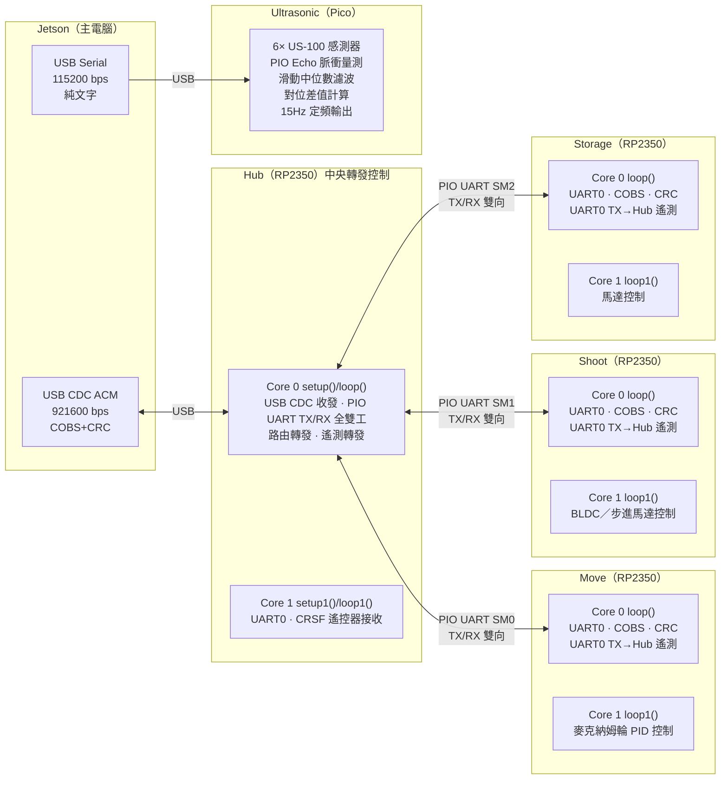

# 棒球機器人 — RP2350 雙核多節點控制韌體

Baseball robot firmware for RP2350 (Waveshare RP2350 Plus / Pico2). Hub ↔ Move / Shoot / Storage slaves, all COBS + Binary struct + CRC16.

## 快速入門

```bash
# 列出可用環境
pio project list

# 建置 + 上傳指定環境
pio run -e pico_hub    -t upload
pio run -e pico_move   -t upload
pio run -e pico_shoot  -t upload
pio run -e pico_storage -t upload
pio run -e ultrasonic  -t upload

# 建置全部（無上傳）
pio run

# 序列監控（觀察 COBS 封包 / printf 輸出）
pio device monitor -e pico_hub
pio device monitor -e pico_move
pio device monitor -e pico_shoot
pio device monitor -e pico_storage

# 清空建置快取
pio run -t clean
```

> `monitor_speed = 115200` (platformio.ini 全域設定)

---

## 目錄結構

```
.
├── platformio.ini           # 多環境編譯設定
├── include/
│   ├── signal_shared.h      # 通訊協定共享標頭（COBS / CRC / 封包結構）
│   └── README
├── lib/
│   ├── ChassisComms/        # 底盤通訊模組（COBS 編解碼、CRC、心跳）
│   ├── CrsfReceiver/        # CRSF 遙控器接收（備援控制用）
│   └── SlaveComms/          # Slave 通用雙核通訊框架
├── src/
│   ├── hub/main.cpp         # 中央轉發節點
│   ├── move/main.cpp        # Move Slave（四輪麥克納姆輪控制）
│   ├── shoot/main.cpp       # Shoot Slave
│   ├── storage/main.cpp     # Storage Slave
│   ├── ultrasonic/          # 超音波獨立節點
│   │   ├── main.cpp         # 6× US-100 感測器、PIO Echo 量測、USB Serial 輸出
│   │   ├── ultrasonic_echo.pio    # PIO 程式（Echo 脈衝寬度量測）
│   │   └── ultrasonic_echo.pio.h  # PIO 程式編譯後標頭
│   └── test/                # 獨立測試程式
├── CLAUDE.md                # 本檔案（開發規範，Claude Code 自動載入）
└── do_build.sh              # 快速建置腳本
```

---

## 系統拓撲



- **Jetson ↔ Hub**：USB CDC ACM，COBS 封幀 + Binary struct + CRC16
- **Hub ↔ Slaves**：PIO UART 全雙工（每條 Slave 一組獨立 PIO SM），Hub Core 0 同時負責 TX 控制與 RX 遙測
- **Ultrasonic**：獨立 Pico 節點，透過 USB Serial（CDC ACM）直接連接 Jetson，純文字協定無 COBS 封幀。使用 PIO 以 GPIO Trigger/Echo 模式輪詢 6 顆 US-100 超音波感測器，每秒約 15Hz 輸出濾波後距離與對位差值。
- **Slave（move / shoot / storage）**：UART0 雙向收發（收 Hub 控制幀 + 回傳遙測）
- **框架**：PlatformIO + [Earlephilhower Arduino-Pico](https://github.com/earlephilhower/arduino-pico) (RP2350)
- **雙核心啟動**：統一 `setup()` (Core 0) → `setup1()` (Core 1)，主迴圈 `loop()` / `loop1()`

---

## 核心分配

### Hub (RP2350)

| Core | 函式 | 職責 |
|------|------|------|
| Core 0 | `setup()` / `loop()` | USB CDC COBS 與 Jetson 收發（jetsonComms）、PIO UART TX 控制命令至所有 Slaves、PIO UART RX 從所有 Slaves 接收遙測、**I/O 全雙工一條龍處理，不需跨核心傳遞**。Jetson 斷線時（逾時 500ms）改用 Core 1 的 RC 數據備援轉發 |
| Core 1 | `setup1()` / `loop1()` | 專職 CRSF 接收機（UART0, GP1 RX, 420000 baud），高頻 `crsf.update()` 解包 + Failsafe 計時器。解完 -100~100 資料後寫入 `rc_channels[]` / `rc_failsafe` 全域變數，供 Core 0 低代價讀取 |

### Hub Core 0 閉環控制邏輯

Core 0 形成獨立閉環系統，避免跨核心傳遞開銷：

1. `jetsonComms.update()` — USB CDC 讀取 + COBS 解包 → 當場依 targetID 呼叫對應 `moveComms.sendPacket()` / `shootComms.sendPacket()` / `storageComms.sendPacket()`
2. Jetson 逾時（>500ms）→ `tryRcFallback()` → 讀取 Core 1 的 RC 數據 → 轉發至所有 Slaves
3. RC 斷線（Failsafe）→ 發送 E-Stop 廣播至所有 Slaves

### Slaves (Move / Shoot / Storage)

| Core | 函式 | 職責 |
|------|------|------|
| Core 0 | `setup()` / `loop()` | 硬體 UART0（預設 TX=GP0, RX=GP1）收發、SlaveComms::update() 收 Hub 控制幀、COBS 解包、CRC 驗證、逾時保護、**寫入共享命令緩衝區→通知 Core 1** |
| Core 1 | `setup1()` / `loop1()` | 馬達初始化、SlaveComms::runCore1() — 自旋等待 Core 0 發命令，執行馬達控制 |

### ⚠️ 注意：所有 Slave 皆使用 UART0 雙向收發（收控制 + 發遙測）。

- Earlephilhower Arduino-Pico 啟動順序：`setup()` (Core 0) → `setup1()` (Core 1)
- `loop()` 和 `loop1()` 分別在兩顆核心獨立運作
- 全域變數雙核心共享，Hub 端使用 `volatile`（編譯器防止過度優化）+ RP2350 SCU 保證 cache coherency
- 各 Slave 透過 SlaveComms 庫使用 `atomic<bool>` + `memory_order release/acquire` 同步
- `Serial` 綁定 Core 0（USB CDC），**禁止在 `setup1()` / `loop1()` 中呼叫 Serial 相關函數**

---

## Hub Core 0 ↔ Core 1 協同機制

Hub 端雙核心透過共用變數協同，無鎖、無 IRQ、無跨核 handshake：

```
Core 1 (loop1):
  while (true) {
    crsf.update();                          // 高頻 CRSF 解包
    crsf.getChannels(ch);                   // 讀取 CRSF 通道 -100~100
    for (...) rc_channels[i] = ch[i];       // 寫入 volatile 全域變數
    rc_failsafe = crsf.isFailsafe();        // 更新斷線狀態
  }

Core 0 (loop):
  jetsonComms.update();                     // USB CDC + 轉發
  if (now - lastJetsonFrameUs > 500ms) {
    memcpy from rc_channels[] / rc_failsafe  // 讀取 RC 備援數據
    sendPacket 至所有 Slaves                  // RC 備援轉發
  }
```

- Core 1 持續寫入 `rc_channels[]` / `rc_failsafe`（`volatile` 共用變數）
- Core 0 在其 `loop()` 中以 `memcpy` 低代價讀取
- RP2350 SCU 保證 cache coherency，無需 `atomic` 操作

---

## Slave 核心間同步機制（SlaveComms 框架）

所有 Slave 共用 `SlaveComms` 框架，Core 1 不設獨立定時器，由 Core 0 收到有效控制幀後觸發。

```
Core 0 (loop):
  1. UART0 收到 COBS 幀 → CRC 驗證
  2. 寫入 sharedCmd（memcpy）+ atomic<bool> store release 通知 Core 1
  3. 若 E-Stop → atomic<bool> 旗標

Core 1 (loop1):
  1. while(true) spinloop
  2. atomic<bool> acquire 檢查 E-Stop / 新命令
  3. 收到通知 → memcpy 快照 sharedCmd → 執行馬達控制 callback
  4. 無命令時可選擇執行 idleHook（如步進馬達增量移動）
```

### 同步流程

1. Hub PIO UART 送出控制幀 → Slave UART0 接收
2. Slave Core 0 收到、解析、CRC 驗證通過
3. Core 0 → Core 1 通知「執行命令」（atomic<bool> release）
4. Core 1 執行馬達控制 callback，設定 flag 為 false
5. 所有 Slave 完成 → 下一個控制週期

### 優點

- 全車硬同步，無累積時序漂移
- Slave 不維護獨立定時器，依賴 Jetson/Hub 控制幀頻率

### 注意事項

- Core 1 執行時間必須 < 控制幀間隔（典型 10–20ms）
- >100ms 無新幀 → E-Stop 觸發，PWM 歸零

---

## 通訊協定

三層架構，鏈路層透明：
```
Binary Struct (struct __attribute__((packed)))
    ↕ 序列化
COBS 編碼 (最大 254 bytes 負載 + 0x00 終止符)
    ↕ 位元組流
USB CDC 或 PIO UART (921600 bps)
```

| 鏈路 | 方向 | 介面 | 速率 |
|------|------|------|------|
| Jetson ↔ Hub | 雙向 | USB CDC ACM (Serial) | 921600 bps |
| Jetson ↔ Ultrasonic | 雙向 | USB CDC ACM | 115200 bps |
| Hub ↔ Move | 雙向 | PIO UART SM0 (TX=GP2, RX=GP3) | 921600 bps |
| Hub ↔ Shoot | 雙向 | PIO UART SM1 (TX=GP4, RX=GP5) | 921600 bps |
| Hub ↔ Storage | 雙向 | PIO UART SM2 (TX=GP6, RX=GP7) | 921600 bps |
| CRSF 接收機 | Hub 接收 | UART0 (GP1 RX) | 420000 bps |

交叉連接方式：
```
Hub PIO UART TX → Slave UART0 RX (GP1)
Slave UART0 TX (GP0) → Hub PIO UART RX

Move：    Hub SM0 TX(GP2) → Move RX(GP1),    Move TX(GP0) → Hub SM0 RX(GP3)
Shoot：   Hub SM1 TX(GP4) → Shoot RX(GP1),   Shoot TX(GP0) → Hub SM1 RX(GP5)
Storage： Hub SM2 TX(GP6) → Storage RX(GP1), Storage TX(GP0) → Hub SM2 RX(GP7)
```

### Binary Struct

- `__attribute__((packed))`，明確寬度型別（int8_t, uint16_t...）
- Header 格式：`sync (0xA5), msgType, frameSeq, targetID, payloadLen`
- **CRC16 在封包尾部（payload 之後）**，計算範圍不含 crc16 欄位自身
- `targetID`：`0=Hub, 1=Move, 2=Shoot, 3=Storage, 0xFF=Broadcast`
- 每個 struct 後 `static_assert(sizeof(Struct) == EXPECTED_SIZE)`
- Little-endian（RP2350 原生）

### msgType 訊息類型

| 值 | 常數 | 方向 | 說明 |
|----|------|------|------|
| 0x01 | HEARTBEAT | Hub → Jetson | 30ms 心跳（可停用） |
| 0x02 | CONTROL | 雙向 | 控制命令（20 bytes ControlPacket） |
| 0x03 | TELEMETRY | Slave → Hub | 遙測回傳（72 bytes MoveTelemetry，50ms 間隔） |
| 0x04 | REBOOT | Hub → Slave | 觸發 Slave watchdog 重開機（20 bytes ControlPacket） |
| 0xFF | ESTOP | 雙向 | 緊急停止（跳過幀序號去重，每次必傳） |

### COBS 封幀

- 負載最大 254 bytes，編碼後補 `0x00` 終止符
- 接收端以 `0x00` 切割解碼
- COBS 解碼具備雙重防禦：來源長度驗證 + 目的地溢位檢查（512 bytes 上限）

### CRC16-CCITT

- 多項式 `0x1021`，初始值 `0xFFFF`
- CRC 表為編譯期 `constexpr` 常數，駐留 Flash，零執行時期初始化
- 計算範圍不含 crc16 欄位自身
- COBS 解碼後立即驗證，失敗靜默丟棄

### 幀序號抗干擾

- 每幀附 `frameSeq`（uint8_t，遞增繞回）
- 接收端記錄最後有效序號，重複跳過，跳號觸發安全機制

---

## 通訊規則

### Hub Core 0 通訊規則

- **USB CDC (Serial)**：Jetson 端，使用 `ChassisComms` 綁定 `&Serial`，30ms 心跳往 Jetson
- **PIO UART TX/RX**：三個 Slave（Move/Shoot/Storage）各自一組獨立 PIO SM，同為 `ChassisComms` 實例綁定 `SerialPIO`，無心跳（`hbIntervalUs=0`，Slave 端已有指令逾時 100ms E-Stop 保護）
- 一個 `loop()` 同時處理所有 I/O，統一呼叫各 `ChassisComms::update()`
- 所有緩衝區靜態分配於 .bss，禁止 new/malloc

### 發送規則（無優先級隊列）

921600 bps 下 20 bytes 約 200μs，無需排隊：

- **控制幀**：Hub Core 0 loop() 中直接寫入 PIO UART TX（每控制週期一幀）
- **心跳**：`ChassisComms` 內部定時器在 `update()` 中觸發，直接寫入 TX FIFO
- **遙測接收**：Slave 硬體 UART TX → Hub PIO UART RX，在 `ChassisComms::update()` 中連帶處理

### 指令超時保護

- **Slave 端**：每顆 Slave 最後有效指令超過 **100ms** 無新幀 → E-Stop 觸發，PWM 歸零（由 `SlaveComms::update()` 中檢查）
- **Hub 端**：Jetson 最後有效幀超過 **500ms** → 切換至 RC 備援模式

### 遙測回傳

- 所有 Slave 使用通訊用的同一組 **UART0 TX**，以約 **50ms 間隔**（20Hz）發送 COBS 遙測封包回 Hub
- Slave Core 1 的 `onCommand()` callback 構建 `MoveTelemetry` → `slave.prepareTelemetry()` 交給 Core 0
- Slave Core 0 的 `SlaveComms::update()` 定時透過 `ChassisComms::sendTelemetry()` 發送
- 遙測包含：四輪 currentRps、targetRps、pwmOutput、車身速度命令、E-Stop 旗標
- 使用專用 struct `MoveTelemetry`（72 bytes, packed），COBS 封幀 + CRC16
- Hub 端 `processPioRx()` 解析遙測封包 → 存入 `latestXxxTm` 變數
- Hub 端 `checkSlaveTimeouts()` 偵測遙測逾時（500ms）→ 發送 `REBOOT` 訊息觸發 Slave 重開機

---

## Core 1 馬達控制規則（Slave端）

- Core 0 通知後立即執行一次控制循環（硬體 PWM+DIR / PIO Encoder / PID）
- 完成後回 spinloop，不阻塞、不 `delay()`
- 可選 `idleHook` 回呼，在無命令時持續執行（如步進馬達增量移動）
- 硬體 PWM — 精確頻率/duty，無中斷抖動
- PIO Encoder 正交解碼 — 硬體計數，零 CPU 開銷

---

## PIO 開發規則

- 指令延遲 `[n]` ≤ 31 cycles
- PIO 僅處理 μs 級高頻調變（UART bit-banging, Encoder）
- ms 級延遲一律用 Hardware Timer 或 Core 1 spinloop（PIO 僅 32–64 words）
- 非 32-bit 倍數資料：手動 push block，不用 autopush
- 釋放 bus 後加 `wait 1 pin` 或足量 nop 防誤觸
- 每段 PIO 程式附週期數註解
- 資源：2 PIO × 4 SM = 8 SM，Hub 用 3 組給 Slave，Move Slave 使用 PIO0 全部 4 SM 做 Encoder

---

## E-Stop 安全機制

- 觸發條件：指令逾時 >100ms、PID NaN / 超物理範圍、frameSeq 異常
- Hub 可發送 E-Stop 廣播（`msgType=ESTOP, targetID=0xFF`）
- Slave Core 0 收到 E-Stop → atomic<bool> `estopActive_` store release → Core 1 歸零 PWM
- Core 1 繼續 spinloop 等待，不 reboot
- E-Stop 解除後收到有效控制幀自動恢復

### Slave 當機重開機 (REBOOT)

- Hub 持續監控各 Slave 的遙測回傳時間
- 若某 Slave 超過 **500ms** 無遙測回傳 → Hub 發送 `msgType=REBOOT` 控制幀
- Slave Core 0 收到 REBOOT → 設定 `rebootRequested_` flag
- Core 0 下次 `update()` 檢測到 flag → 呼叫 `watchdog_reboot(0, 0, 0)` 執行 RP2350 標準重開機
- 重開機後 Slave 從 `setup()` 重新初始化，Hub 等待新遙測恢復連線

---

## CRSF 遙控器備援

Hub Core 1 專職執行 CRSF 接收機，在 Jetson 斷線時提供備援控制。

### 接線

```
ELRS 接收機 TX → Hub GP1 (UART0 RX)
需在 ELRS 接收機設定 serial_inverted = off
UART0 @ 420000 baud
```

### RC 通道分配

| 通道 | 變數 | 用途 | 目標 Slave |
|------|------|------|-----------|
| CH1 (Roll) | rc_channels[0] | vx（左右平移） | Move |
| CH2 (Pitch) | rc_channels[1] | vy（前後移動） | Move |
| CH3 (Throttle) | rc_channels[2] | upSpeed（上射速度） | Shoot |
| CH4 (Yaw) | rc_channels[3] | omega（旋轉） | Move |
| CH5 | rc_channels[4] | downSpeed（下射速度） | Shoot |
| CH7 | rc_channels[6] | pitch（俯仰） | Shoot |
| CH8 | rc_channels[7] | row（旋轉） | Shoot |
| CH9 | rc_channels[8] | motorChannel（PCA9685 通道 0~15） | Storage |
| CH10 | rc_channels[9] | trigger（0/1） | Storage |

### 備援邏輯

1. Jetson 正常發送 → Core 0 直接轉發至 Slaves（自動模式）
2. Jetson 逾時（>500ms）→ Core 0 改用 Core 1 的 RC 數據（備援）
3. RC 也斷線（Failsafe）→ 發送 E-Stop 廣播至所有 Slaves
4. 死區濾波：-10~10 → 0，避免微小抖動

---

## 實體硬體與週邊配置

### 1. Hub 節點腳位
- Move Slave 通訊: PIO0 SM0 -> TX: GP2, RX: GP3
- Shoot Slave 通訊: PIO0 SM1 -> TX: GP4, RX: GP5
- Storage Slave 通訊: PIO0 SM2 -> TX: GP6, RX: GP7
- CRSF 接收機: UART0 -> RX: GP1 (420000 baud)

### 2. Move Slave 節點腳位與參數
- UART0 映射: TX: GP0, RX: GP1 (與 Hub 通訊)
- 馬達驅動型式: 硬體 PWM + DIR (非 PIO PWM)
- 四輪腳位（依 `src/move/main.cpp` `Pin` namespace 實測驗證結果）:
  **FR(PWM:GP6, DIR:GP7), FL(PWM:GP9, DIR:GP8), BR(PWM:GP10, DIR:GP11), BL(PWM:GP12, DIR:GP13)**
- 四輪編碼器 PIO 腳位（依實際實測驗證）:
  FR(A:GP14, B:GP15), FL(A:GP16, B:GP17), BR(A:GP20, B:GP21), BL(A:GP18, B:GP19)
- PIO 資源: PIO0 全部 4 SM 做 Encoder，PIO1 未使用
- 馬達參數: 1:27 減速比, 實測線數 `ENC_LINE_PPR = 443` (軟體常數 `ENC_COUNTS_PER_REV = 443 * 4 = 1772`)
- 車身參數: HALF_LENGTH=0.25m, HALF_WIDTH=0.25m, WHEEL_RADIUS=0.05m
- 馬達極性/編碼器方向: `kWheelPolarity[]` = `{1,-1,1,-1}`（FR/BR 反相）; `kEncReadPolarity[]` = `{1,-1,1,-1}`（FR/BR 鏡像）; 車身軸方向開關 `kAxisStrafePolarity=+1`, `kAxisForwardPolarity=-1`
- 車身三軸 S 曲線速度剖面（jerk-limited 非對稱加/減速）: 加速 4.0, 減速 12.0, Jerk 60.0 RPS/s²
- 閉迴路 PID 上限: `PID_MAX_DUTY=100%`，積分風扇餘裕 `WINDUP_MARGIN_DUTY=6%`
- 期望控制週期: 由 Jetson/Hub 控制幀頻率決定（典型 10–20ms）
- **狀態 LED（板載 `LED_BUILTIN`）**: E-Stop→常亮, 已連線(<100ms 有效命令)→閃爍, 斷線→熄滅（`updateStatusLed()` 於 Core 0 loop() 呼叫）

### 3. Shoot Slave 節點腳位與參數
- UART0: TX: GP0, RX: GP1 (與 Hub 通訊)
- 硬體 PWM: UP_BLDC(GP2), DOWN_BLDC(GP3), FIXED_BLDC(GP4) — 50Hz servo-style PPM
- 步進馬達: PITCH_STEP(GP5), PITCH_DIR(GP6), ROW_STEP(GP7), ROW_DIR(GP8), STEPPER_ENABLE(GP9)
- 無刷馬達脈衝: 1500μs = 中立/停止, 2000μs = 全速
- 步進配置: 1.8°/step, 全步進
- upSpeed/downSpeed 為永久性速度設定（EEPROM 持久化，每次開機自動恢復）

### 4. Storage Slave 節點腳位與參數
- UART0: TX: GP0, RX: GP1 (與 Hub 通訊)
- PCA9685: I2C1 (SDA:GP2, SCL:GP3), 預設位址 0x40
- PCA9685 通道 0~9 連接 10 顆伺服馬達
- Trigger 步進馬達: STEP(GP4), DIR(GP5), STEPPER_ENABLE(GP6)
- 伺服脈衝: 500~2500μs (每通道可個別設定關閉/開啟位置)

### 5. Ultrasonic 節點
- 獨立 Pico 節點（非 RP2350）
- 6× US-100 感測器，PIO Echo 脈衝量測
- 滑動中位數濾波 + 對位差值計算
- 15Hz 定頻輸出至 USB Serial

---
## 強制性編譯檢查

- 在實作任何通訊與馬達控制時，若程式碼違反本規範中的雙核同步機制或記憶體屏障語意，必須立即停止並向用戶回報，不得嘗試強行編譯。
- 本專案嚴格禁止使用任何 `new`/`malloc` 動態記憶體分配，所有緩衝區必須為靜態分配（`static`/global）。

---

## 程式碼風格

- 禁止 C-style cast，強制 `static_cast` / `reinterpret_cast`
- 變數 camelCase，類別 PascalCase，巨集/腳位 UPPER_SNAKE_CASE
- 所有 GPIO 標註實體 pin 編號（`GP6 = Pin 12`）
