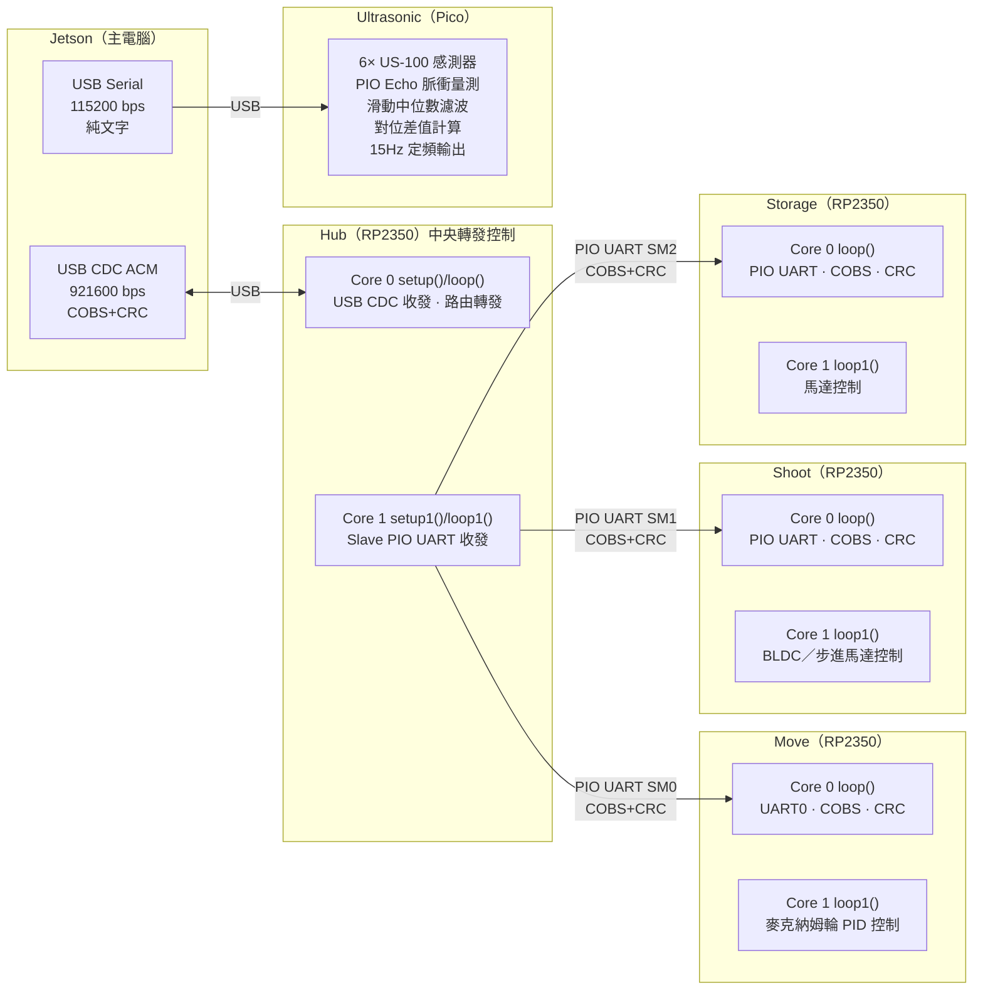

# 棒球機器人 — RP2350 雙核多節點控制韌體

Baseball robot firmware for RP2350 (Pico2). Hub ↔ Move / Shoot / Storage slaves, all COBS + Binary struct + CRC16.

## 快速入門

```bash
# 列出可用環境
pio project list

# 建置 + 上傳指定環境
pio run -e pico_hub    -t upload
pio run -e pico_move   -t upload
pio run -e pico_shoot  -t upload
pio run -e pico_storage -t upload
pio run -e ultrasonic  -t upload

# 建置全部（無上傳）
pio run

# 序列監控（觀察 COBS 封包 / printf 輸出）
pio device monitor -e pico_hub
pio device monitor -e pico_move
pio device monitor -e pico_shoot
pio device monitor -e pico_storage

# 清空建置快取
pio run -t clean
```

> `monitor_speed = 115200` (platformio.ini 全域設定)

---

## 目錄結構

```
.
├── platformio.ini           # 多環境編譯設定
├── include/
│   ├── signal_shared.h      # 通訊協定共享標頭（COBS / CRC / 封包結構）
│   └── README
├── lib/
│   ├── ChassisComms/        # 底盤通訊模組（COBS 編解碼、CRC、心跳）
│   └── CrsfReceiver/        # CRSF 遙控器接收（備援控制用）
├── src/
│   ├── hub/main.cpp         # 中央轉發節點
│   ├── move/main.cpp        # Move Slave（四輪麥克納姆輪控制）
│   ├── shoot/main.cpp       # Shoot Slave
│   ├── storage/main.cpp     # Storage Slave（未實作）
│   ├── ultrasonic/          # 超音波獨立節點
│   │   ├── main.cpp         # 6× US-100 感測器、PIO Echo 量測、USB Serial 輸出
│   │   ├── ultrasonic_echo.pio    # PIO 程式（Echo 脈衝寬度量測）
│   │   └── ultrasonic_echo.pio.h  # PIO 程式編譯後標頭
│   └── test/                # 獨立測試程式
├── agent.md                 # 本檔案（開發規範，Claude Code 自動載入）
└── do_build.sh              # 快速建置腳本
```

---

## 系統拓撲



- **Jetson → Hub**：USB CDC ACM，COBS 封幀 + Binary struct + CRC16
- **Hub → Slaves**：PIO UART，COBS 封幀 + Binary struct + CRC16（每條獨立 PIO link）
- **Ultrasonic**：獨立 Pico 節點，透過 USB Serial（CDC ACM）直接連接 Jetson，純文字協定無 COBS 封幀。使用 PIO 以 GPIO Trigger/Echo 模式輪詢 6 顆 US-100 超音波感測器，每秒約 15Hz 輸出濾波後距離與對位差值。
- **Slave（move）**：硬體 UART0 收發（與 Hub PIO UART 相容，baud rate 一致即可互通）
- **Slave（shoot / storage）**：PIO UART 收發（非硬體 UART），腳位自由指定、精確 bit timing
- **框架**：PlatformIO + [Earlephilhower Arduino-Pico](https://github.com/earlephilhower/arduino-pico) (RP2350)
- **雙核心啟動**：統一 `setup()` (Core 0) → `setup1()` (Core 1)，主迴圈 `loop()` / `loop1()`

---

## 核心分配

### Hub (RP2350)

| Core | 函式 | 職責 |
|------|------|------|
| Core 0 | `setup()` / `loop()` | USB CDC 初始化、與 Jetson USB 收發 COBS 幀、路由轉發 |
| Core 1 | `setup1()` / `loop1()` | 各 Slave PIO UART 初始化、與 Slaves PIO UART 收發 |

### Slaves (Move / Shoot / Storage)

| Core | 函式 | 職責 |
|------|------|------|
| Core 0 | `setup()` / `loop()` | 硬體 UART0 / PIO UART 收發、COBS 解包、CRC 驗證、指令解析、通知 Core 1 |
| Core 1 | `setup1()` / `loop1()` | 馬達初始化、**由 Core 0 觸發**執行馬達控制 |

### ⚠️ 注意：Move Slave 使用硬體 UART0，Shoot / Storage Slave 使用 PIO UART

- Earlephilhower Arduino-Pico 啟動順序：`setup()` (Core 0) → `setup1()` (Core 1)
- `loop()` 和 `loop1()` 分別在兩顆核心獨立運作
- 全域變數雙核心共享，需 atomic + memory_order 同步（見 §核心間通訊）
- `Serial` 綁定 Core 0（USB CDC），**禁止在 `setup1()` / `loop1()` 中呼叫 Serial 相關函數**

---

## Slave 核心間同步機制

**Core 1 不設獨立定時器，由 Core 0 收到有效控制幀後觸發。**

```
Core 0 (loop):
  1. PIO UART 收到 COBS 幀 → CRC 驗證
  2. 寫入雙緩衝區 → atomic store release 通知 Core 1
  3. spinloop 等待 Core 1 完成

Core 1 (loop1):
  1. spinloop 輪詢 atomic acquire
  2. 收到通知 → memcpy 快照命令 → 執行馬達控制
  3. 標示 done，回到輪詢
```

### 同步流程

1. Jetson 送出控制幀 → Hub 接收 → 轉發至所有 Slave
2. 各 Slave Core 0 收到、解析、CRC 驗證通過
3. Core 0 → Core 1 通知「執行命令」
4. Core 1 執行馬達控制，標示完成
5. 所有 Slave 完成 → 下一個控制週期

### 優點

- 全車硬同步，無累積時序漂移
- Slave 不維護獨立定時器，依賴 Jetson 控制幀頻率

### 注意事項

- Core 1 執行時間必須 < 控制幀間隔（典型 10–20ms）
- >100ms 無新幀 → E-Stop 觸發，PWM 歸零

---

## 核心間通訊

### 無鎖雙緩衝區

```cpp
static struct SlaveCommand cmdBuf[2];
static std::atomic<uint8_t> cmdWriteIdx{0};
```

**⚠️ `volatile` 無記憶體屏障**：RP2350 SCU 保證 cache coherency，但執行序重排仍需 acquire/release。

**寫入者 (Core 0)：**
1. 寫入 `cmdBuf[writeIdx]`
2. `cmdWriteIdx.store(idx, std::memory_order_release)` — 保證所有寫入在 store 前對其他核心可見

**讀取者 (Core 1)：**
1. `uint8_t idx = cmdWriteIdx.load(std::memory_order_acquire)`
2. `memcpy` 快照 `cmdBuf[writeIdx ^ 1]` 到本地

**E-Stop 旗標：**
```cpp
Core 0: estopActive.store(true, std::memory_order_release);
Core 1: if (estopActive.load(std::memory_order_acquire)) { pwmZero(); }
```

---

## 通訊協定

三層架構，鏈路層透明：
```
Binary Struct (struct __attribute__((packed)))
    ↕ 序列化
COBS 編碼 (最大 254 bytes 負載 + 0x00 終止符)
    ↕ 位元組流
USB CDC 或 PIO UART (921600 bps)
```

| 鏈路 | 介面 | 速率 |
|------|------|------|
| Jetson ↔ Hub | USB CDC ACM (Serial) | 921600 bps |
| Jetson ↔ Ultrasonic | USB CDC ACM | 115200 bps | ❌ 裸文字串 |
| Hub ↔ Move | PIO UART SM0 ↔ Move UART0 | 921600 bps |
| Hub ↔ Shoot | PIO UART SM1 | 921600 bps |
| Hub ↔ Storage | PIO UART SM2 | 921600 bps |

### Binary Struct

- `__attribute__((packed))`，明確寬度型別（int8_t, uint16_t...）
- Header 格式：`sync (0xA5), msgType, frameSeq, targetID, payloadLen, crc16`
- `targetID`：`0=Hub, 1=Move, 2=Shoot, 3=Storage, 0xFF=Broadcast`
- 每個 struct 後 `static_assert(sizeof(Struct) == EXPECTED_SIZE)`
- Little-endian（RP2350 原生）

### COBS 封幀

- 負載最大 254 bytes，編碼後補 `0x00` 終止符
- 接收端以 `0x00` 切割解碼

### CRC16-CCITT

- 多項式 `0x1021`，計算範圍不含 crc16 欄位自身
- COBS 解碼後立即驗證，失敗靜默丟棄

### 幀序號抗干擾

- 每幀附 `frameSeq`（uint8_t，遞增繞回）
- 接收端記錄最後有效序號，重複跳過，跳號觸發安全機制

---

## 通訊規則

### Core 0 通訊規則

- PIO UART RX → IRQ + ring buffer（不輪詢、不阻塞）
- Hub Core 0 使用 USB CDC ACM（非 UART），同樣 COBS + CRC
- `Serial.print()` / `printf()` 走 USB CDC
- 所有緩衝區靜態分配於 .bss，禁止 new/malloc

### 發送規則（無優先級隊列）

921600 bps 下 20 bytes 約 200μs，無需排隊：

- **心跳**：Hardware Timer 每 30ms 觸發，直接寫入 TX FIFO
- **遙測**：檢查 `availableForWrite()`，空間不足直接丟棄、不排隊
- 心跳固定週期自然優先，遙測可丟，無需 Priority Queue

### 指令超時保護

每顆 Slave 最後有效指令超過 **100ms** 無新幀 → E-Stop 觸發，PWM 歸零。

---

## Core 1 馬達控制規則

- Core 0 通知後立即執行一次控制循環（PIO PWM / Encoder / PID）
- 完成後回 spinloop，不阻塞、不 `delay()`
- PIO 硬體 PWM — 精確頻率/duty，無中斷抖動
- PIO Encoder 正交解碼 — 硬體計數，零 CPU 開銷
- IRQ 明確綁定 Core 1
- 關鍵熱路徑函數加 `__not_in_flash_func()` 置入 SRAM

---

## PIO 開發規則

- 指令延遲 `[n]` ≤ 31 cycles
- PIO 僅處理 μs 級高頻調變（UART bit-banging, Encoder）
- ms 級延遲一律用 Hardware Timer 或 Core 1 ISR（PIO 僅 32–64 words）
- 非 32-bit 倍數資料：手動 push block，不用 autopush
- 釋放 bus 後加 `wait 1 pin` 或足量 nop 防誤觸
- 每段 PIO 程式附週期數註解
- 資源：2 PIO × 4 SM = 8 SM，Hub 最多用 3 組給 Slave

---

## E-Stop 安全機制

- 觸發條件：指令逾時 >100ms、PID NaN / 超物理範圍、frameSeq 異常
- Hub 可發送 E-Stop 廣播（`targetID=0xFF`）
- Slave Core 0 收到 E-Stop → `estopActive.store(true, release)` → Core 1 歸零 PWM
- Core 1 繼續等待，不 reboot
- E-Stop 解除後強制 Slew Rate Limiter 漸進加速

---

## 強制性編譯檢查

- 在實作任何通訊與馬達控制時，若程式碼違反本規範中的雙核同步機制或記憶體屏障語意，必須立即停止並向用戶回報，不得嘗試強行編譯。
- 本專案嚴格禁止使用任何 `new`/`malloc` 動態記憶體分配，所有緩衝區必須為靜態分配（`static`/global）。

---

## 程式碼風格

- 禁止 C-style cast，強制 `static_cast` / `reinterpret_cast`
- 變數 camelCase，類別 PascalCase，巨集/腳位 UPPER_SNAKE_CASE
- 所有 GPIO 標註實體 pin 編號（`GP16 = Pin 21`）

