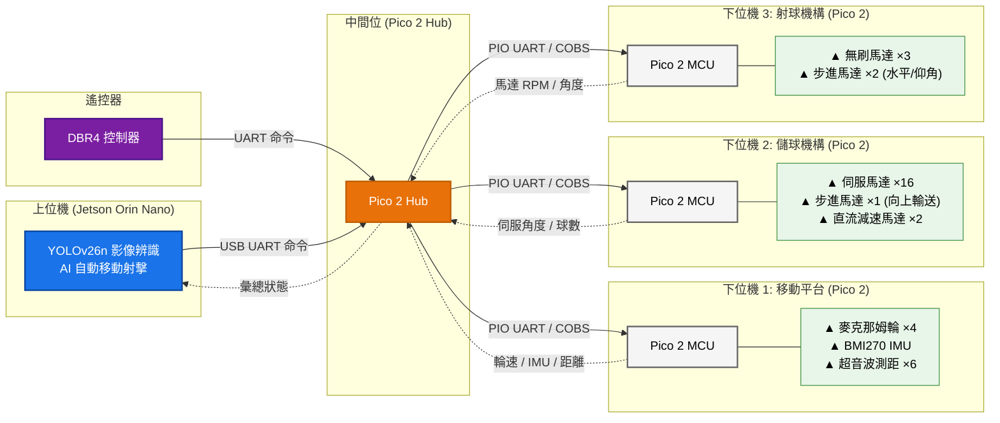
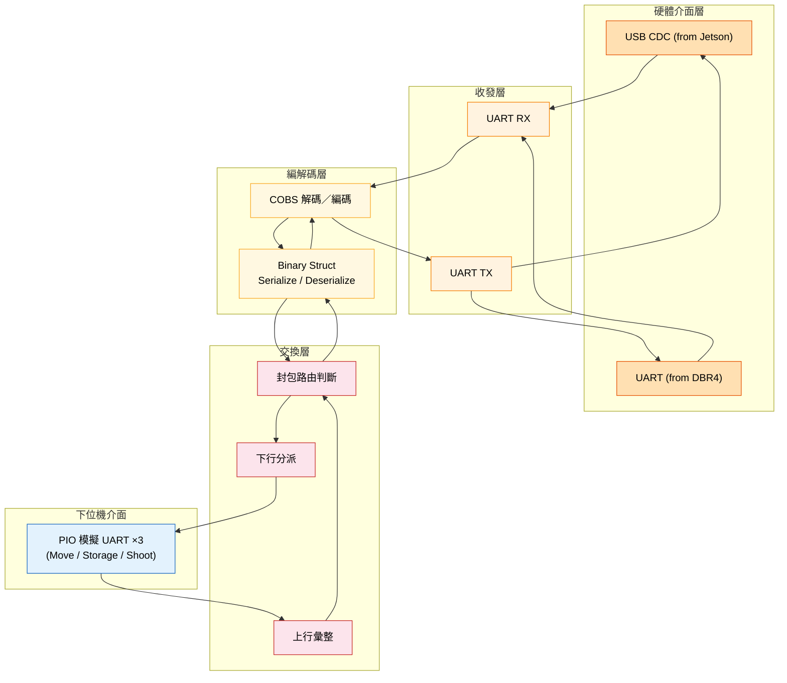

# 系統架構圖

## Hub 內部架構

## 資料流向

| 方向 | 路徑 | 內容 |
|------|------|--------|
| 下行 | Jetson → Hub → 下位機 | 移動指令、儲球指令、射球參數 |
| 下行 | DBR4 → Hub → 下位機 | 遙控器操作命令 |
| 上行 | 下位機 1 → Hub → Jetson | 四輪轉速、六軸超音波距離、IMU 姿態 |
| 上行 | 下位機 2 → Hub → Jetson | 16 顆伺服角度、步進馬達位置、直流馬達轉速、儲球數量 |
| 上行 | 下位機 3 → Hub → Jetson | 三顆無刷馬達 RPM、水平/仰角步進角度、射擊狀態 |
